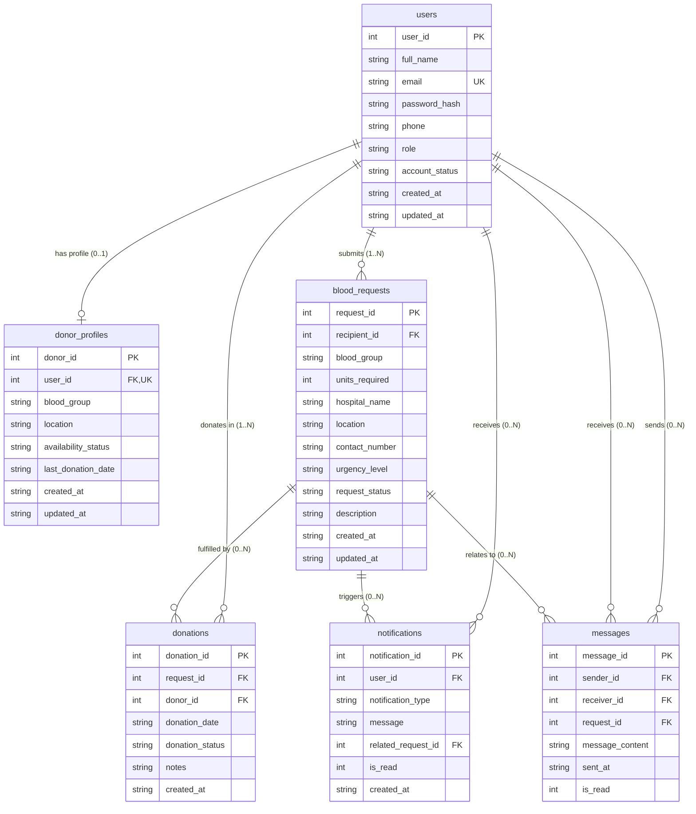

# BloodLink – Entity Relationship (ER) Diagram

## 1. Overview
This document specifies the conceptual, logical, and physical entity relationships in the BloodLink system.

---

## 2. Mermaid Entity-Relationship Diagram

---

## 3. Cardinalities and Referential Actions

| Parent Table | Child Table | Relationship | On Delete | On Update | Business Logic |
| :--- | :--- | :--- | :--- | :--- | :--- |
| `users` | `donor_profiles` | 1-to-1 (Optional) | `CASCADE` | `CASCADE` | Deleting a user purges their donor profile. |
| `users` | `blood_requests` | 1-to-Many | `CASCADE` | `CASCADE` | Deleting a recipient removes their active/past requests. |
| `users` | `donations` | 1-to-Many | `RESTRICT` | `CASCADE` | Historical donation records cannot be orphaned or deleted arbitrarily. |
| `blood_requests` | `donations` | 1-to-Many | `RESTRICT` | `CASCADE` | Requests with logged donations cannot be removed without explicit audit. |
| `users` | `notifications` | 1-to-Many | `CASCADE` | `CASCADE` | Notifications are owned by the recipient user. |
| `blood_requests` | `notifications`| 1-to-Many (Optional)| `SET NULL` | `CASCADE` | Deleting a request nullifies the request reference on notifications. |
| `users` | `messages` (`sender_id`) | 1-to-Many | `CASCADE` | `CASCADE` | User deletion purges associated chat records. |
| `users` | `messages` (`receiver_id`) | 1-to-Many | `CASCADE` | `CASCADE` | User deletion purges associated chat records. |
| `blood_requests` | `messages` | 1-to-Many (Optional) | `SET NULL` | `CASCADE` | General conversation preserved even if specific request is cleared. |

