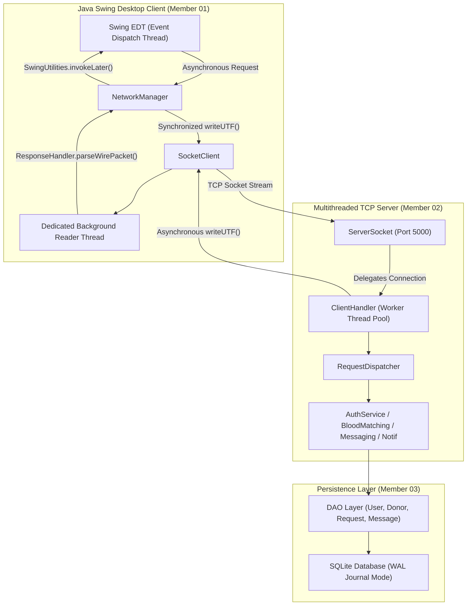

# BloodLink – Network Architecture & Multithreading Guide

## 1. High-Level Architecture Overview

BloodLink implements a classic 3-tier Client-Server distributed architecture using native Java TCP Sockets (`Socket` and `ServerSocket`).



---

## 2. Core Networking Principles

### A. Why TCP Instead of UDP?
1. **Guaranteed Delivery:** Blood requests, medical urgency alerts, and user registration data cannot tolerate packet loss.
2. **In-Order Transmission:** Direct messaging and status transitions must arrive strictly in the sequence they were generated.
3. **Connection State:** The server maintains continuous awareness of authenticated donor availability through persistent TCP socket sessions.

### B. Single-Reader Thread Pattern
In a bidirectional client socket, both synchronous request responses (`RES`) and asynchronous push events (`EVENT` or `MSG`) arrive over the same incoming stream:
* **The Pitfall:** If worker threads independently invoked `in.readUTF()`, they would race to consume bytes. A synchronous request might swallow an incoming chat message intended for another screen, corrupting protocol state.
* **The Solution:** Member 01 implements a **single, dedicated background reader thread** (`BloodLink-SocketReader`) in `SocketClient`.
  * The reader thread continuously invokes `in.readUTF()`.
  * For `RES` packets, it looks up the correlating `CompletableFuture` in `pendingRequests` using `requestId`.
  * For `EVENT` or `MSG` packets, it notifies registered `PushEventListener` callbacks.

### C. Synchronized Socket Writes
While incoming packets have a single reader, multiple UI components may trigger outgoing packets simultaneously (e.g. typing in chat while refreshing donor lists).
* In `SocketClient.send(wireString)`, access to `out.writeUTF()` is guarded by a dedicated `writeLock` object to prevent stream interleaving and UTF framing corruption:
  ```java
  public void send(String wireString) throws IOException {
      synchronized (writeLock) {
          out.writeUTF(wireString);
          out.flush();
      }
  }
  ```

---

## 3. Concurrency & Swing EDT Safety

### The Swing Single-Thread Rule
Swing GUI components (`JFrame`, `JTable`, `JLabel`, etc.) are not thread-safe. They must only be accessed or modified from the **Event Dispatch Thread (EDT)**.
* Blocking socket operations (`connect()`, `readUTF()`) are **never** executed on the EDT, ensuring the UI never freezes or stutters.
* When the background reader thread receives an incoming packet or event, it wraps the UI update in `SwingUtilities.invokeLater()`:
  ```java
  SwingUtilities.invokeLater(() -> {
      for (PushEventListener listener : pushListeners) {
          listener.onUrgentAlertReceived(bloodGroup, hospital, city, urgency, title);
      }
  });
  ```

---

## 4. Request-Response Correlation (`CompletableFuture`)

Because TCP communication is non-blocking, BloodLink uses request correlation IDs:
1. Client generates unique token `req_101`.
2. Client registers an uncompleted `CompletableFuture<ParsedResponse>` in `pendingRequests.put("req_101", future)`.
3. Client attaches an 8-second timeout task via `ScheduledExecutorService`.
4. Server processes the request and sends `RES|ACTION|req_101|STATUS|PAYLOAD`.
5. Background reader pops the future: `pendingRequests.remove("req_101").complete(response)`.
6. UI receives the result asynchronously via `.thenAccept(...)` on the EDT.

---

## 5. Disconnection & Lifecycle Handling
* **Graceful Disconnect:** Sent upon user logout or application exit via JVM shutdown hook.
* **Server Shutdown:** Detected immediately when `in.readUTF()` throws `EOFException` or `SocketException`. All pending futures are failed with `IOException("Disconnected from server")`, and the UI connection badge transitions to `OFFLINE`.
